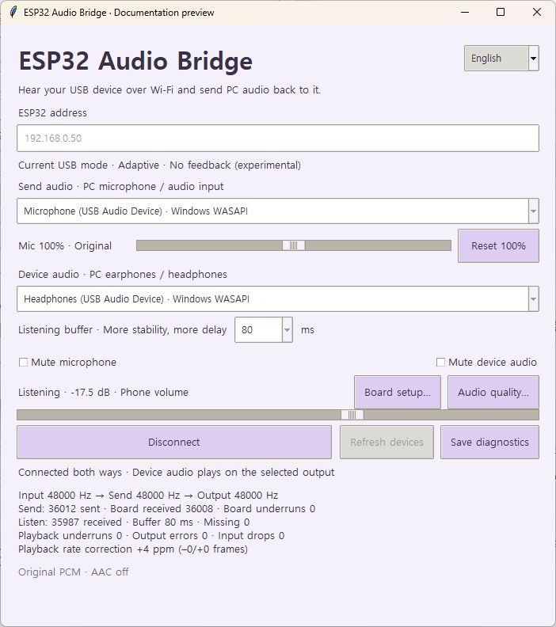
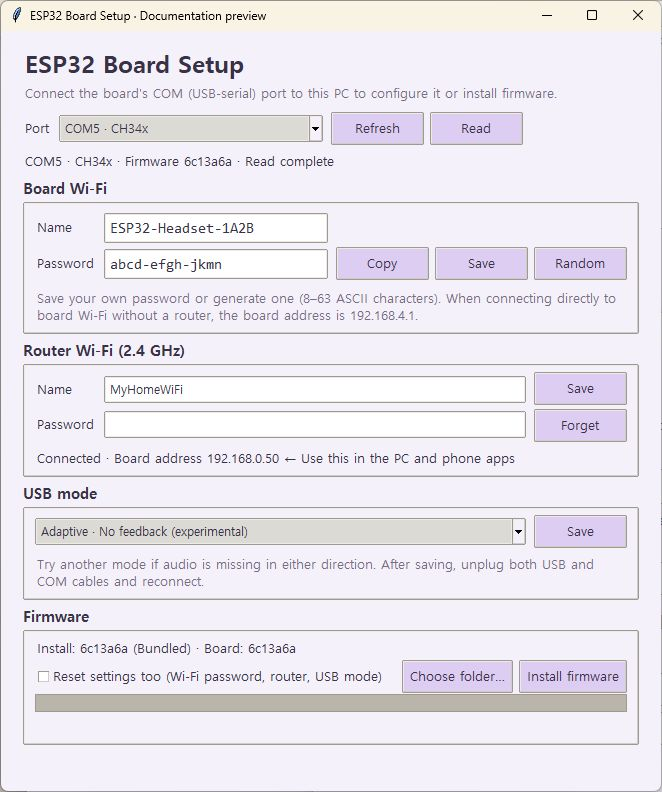

# ESP32 Wi-Fi USB Headset

**English** | [한국어](README.ko.md)

**A Wi-Fi ↔ USB audio bridge.** An ESP32-S3 board plugs into any device that supports USB audio as a USB headset, and lets you **hear that device on your computer over Wi-Fi**. In the other direction, your computer's microphone becomes that device's microphone.

It works with anything that recognizes a USB headset, such as a phone, a tablet or another PC. Listen to what the device plays (video, games, music, calls) on the headphones of the computer you are already using, without a cable, and talk to the device through your computer's microphone. Move the board between devices, or keep one board per device, to listen to several devices from one computer in turn.

```text
PC microphone → ESP32 Audio Bridge → Wi-Fi → ESP32 → USB microphone → device
PC headphones ← ESP32 Audio Bridge ← Wi-Fi ← ESP32 ← USB speaker    ← device
```

- [`firmware/`](firmware/): ESP32-S3 firmware. A USB Audio Class 2 headset plus Wi-Fi UDP audio.
- Repository root: the Windows app **ESP32 Audio Bridge**, which connects your computer's microphone and headphones to the board, and **ESP32 Board Setup**, which installs the firmware and sets up the board over its COM cable.
- [PROTOCOL.md](PROTOCOL.md): the UDP format the board speaks. Any other program can send and receive it too.

| ESP32 Audio Bridge | ESP32 Board Setup |
|---|---|
|  |  |

Screenshots show the real English UI with example addresses, devices, Wi-Fi credentials and counters. They illustrate the controls, not a live hardware test. See the [Korean README](README.ko.md) for Korean screenshots.

> **⚠️ This is an experimental project.** Wi-Fi and USB packet problems can still make the sound drop out, crackle or degrade now and then. How often depends on the device and the network. Do not rely on it yet for important calls, streams or recordings.

The Windows programs support **English and 한국어**. Choose a language at the top right of Audio Bridge; it changes immediately without interrupting audio and is saved for the next launch. The first launch follows the Windows locale (Korean for a Korean locale, English otherwise). Audio quality dialogs, connection details and board setup opened from the app use the selected language. Reopen an already open board setup window to apply a new language. Device names stay as reported by Windows. Both the [firmware installation guide](FIRMWARE_INSTALL.md) and the steps below use the English UI labels.

## What you need

- An **ESP32-S3-N16R8** board (16 MB flash). It was tested on a board with separate **COM** (flashing and logs) and **USB/OTG** (audio) ports.
- Two USB data cables: COM ↔ computer for flashing, USB ↔ the device you want to hear.
- A Windows computer and a 2.4 GHz Wi-Fi router. The computer can be on the same router by cable or 5 GHz.

## How to use

1. **Get the PC programs:** download the `ESP32-Audio-Bridge-Windows` ZIP from a successful [ESP32 Audio Bridge Windows Actions run](https://github.com/ys05086/esp32-wifi-usb-headset/actions/workflows/windows.yml) and unzip it. It holds `ESP32AudioBridge.exe` (listen and talk), `ESP32BoardSetup.exe` (board setup and firmware) and the firmware itself. Keep the `_internal` and `setup_files` folders next to them; Python is not needed. Open Audio Bridge and select **English** at the top right if necessary.
2. **Install the firmware:** connect the board's **COM** port to the computer and run `ESP32BoardSetup.exe` (also under **Board setup…** in the app). It finds the port; press **Install firmware**. Later updates work the same way and keep the board's settings. To flash by hand with esptool instead, see the [firmware install guide](FIRMWARE_INSTALL.md).
3. **Set up Wi-Fi:** in the same window, enter your 2.4 GHz router's name and password under **Router Wi-Fi (2.4 GHz)** and press **Save**. Once the board has joined, its address on the router appears below; note it. The window also shows the board's own Wi-Fi, **`ESP32-Headset-XXXX`**, with a password made at random for each board; type your own there and save, or make a new random one. Without a router, join that Wi-Fi directly and use 192.168.4.1.
4. **Plug into the device:** connect the board's **USB** port to the device you want to hear. A USB audio device named **`ESP32 Wi-Fi Headset`** appears on it. Phones usually switch to it on their own; on a Windows PC, pick the USB headset speaker and microphone endpoints (their names depend on Windows and the USB driver) in the sound settings.
5. **Connect from the computer:** in the PC app, enter the board's address under **ESP32 address**. Pick your microphone (or an audio interface or virtual cable) under **Send audio · PC microphone / audio input** and your headphones under **Device audio · PC earphones / headphones**, then press **Connect**.
6. **Listen:** the device's sound now plays on your computer's headphones, and your computer's microphone reaches the device's microphone. To switch devices, move the board or connect to another board's address.

If sound works in only one direction or not at all, change **USB mode** in the setup program, save, then unplug **both** the board's USB and COM cables and plug them back in. What worked in testing (your devices may differ):

| Device the board is plugged into | Setting that worked |
|---|---|
| Windows PC | Standard |
| iPhone | Adaptive (with Standard, only the microphone direction worked) |
| Galaxy | Apple |
| iPhone | Apple (worked fine, but may have issues) |

**Good to know**

- Listen on **headphones**. With speakers, the device's sound reaches your computer's microphone and goes back to the device. Never route the device's sound back into the microphone or a virtual cable.
- The delay is the board buffer (about 60–100 ms) plus the USB buffer (about 30 ms), the PC listening buffer (40/80/120 ms) and the Wi-Fi.
- One board takes one program at a time. Stop the connection before switching programs.
- Each board makes its own Wi-Fi password on first boot; only the setup program (over the COM cable) shows it. Settings change only over that cable or from the board's own Wi-Fi; from the router side the board's page shows status only.
- Audio travels as unencrypted UDP, and any device on the same router can send to the board. Use it on a network you trust.
- If you hear dropouts, press **Save diagnostics** in the PC app (see below).

The code and documentation written for this repository are under the [MIT License](LICENSE) (the firmware: [firmware/LICENSE](firmware/LICENSE)). Third-party software and its notices keep their own licenses; see [THIRD_PARTY_NOTICES.md](THIRD_PARTY_NOTICES.md), `licenses/` and [LICENSING.md](LICENSING.md). The review of the full binary distribution terms is still in progress.

## ESP32 Audio Bridge in detail

The **Send audio · PC microphone / audio input** list shows WASAPI devices first, and also offers virtual cables that only appear through another driver API. The WASAPI/MME/DirectSound/WDM-KS suffix is the access method. To keep the settings of an older version, copy its `settings.json` into the new folder.

The listening buffer is 80 ms by default; choose 40, 80 or 120 ms before connecting. A larger buffer absorbs more late packets at the cost of delay. Late packets are put back in order up to their play deadline, and playback resumes right after a single underrun. A longer gap refills the buffer, and data older than 300 ms is dropped. The app follows the incoming stream rate and adjusts how many frames it consumes to keep the listening buffer bounded; the firmware has its own correction for the microphone direction. This reduces clock-drift accumulation but does not guarantee dropout-free audio.

If you hear dropouts, press **Save diagnostics**. It saves, without any audio, a JSON file with device names, sample rates, packet arrival times, reordering, underruns, device errors and the board's counters. **Board underruns** concerns the sending path, **Playback underruns** the receiving path. Zeros do not prove that the board's USB audio itself is clean.

With firmware that supports it, **Listening volume** is linked with the phone's volume. Pressing the iPhone's volume buttons moves the slider, and moving the slider sets the board's level; whichever side changed it last wins, and a phone volume change takes it back. The board applies the level: the left end is silence, the right end 0 dB. The phone's own volume display does not follow a change made on the PC. A phone that scales the stream itself (some Android phones) keeps its own volume, and the slider adjusts on top of it. With older firmware the slider turns the sound down on the PC only. It is separate from the Windows volume.

Below the address the app shows the board's **current USB mode**, read about every 3 seconds; a saved setting only shows after the board restarts. The query runs on its own thread, apart from the audio. If the board does not answer, the mode shows as unknown, and the diagnostics JSON keeps the last query time and the board's USB transfer counters.
Standard is the Windows-compatible profile and Apple the Apple-compatible one; neither is limited to that operating system. Adaptive is an experimental profile without speaker feedback. Keep whatever already works. USB compatibility concerns the device on the USB side, not the computer on the Wi-Fi side.

The address and device names are saved in `settings.json` next to the executable. Start the app after the audio devices are connected.
The two-way firmware is required; the older microphone-only firmware does not answer this app.
Audio is 48 kHz PCM16, mono in each network direction.
The app checks each audio device's supported formats. Devices without 48 kHz (some capture cards) open at their default rate (e.g. 96 kHz) and go through a streaming resampler, which adds filter delay and an input buffer. The status line shows the actual rates.

## Microphone volume

The **Mic** slider below the input device controls outgoing audio from 0–200%, default 100% (unchanged). Zero is silent and 200% doubles amplitude (about +6 dB). **Reset 100%** restores unity. It works while connected, applies to newly captured audio, and saves automatically in `settings.json`; older settings default to 100%.

Gain is applied after mono downmix, before resampling and AAC encoding. Changes ramp over 10 ms without an additional audio buffer; audio already queued or sent retains its previous level. Listening volume and the phone's volume are independent. Excessive boost saturates at the PCM limits and can distort: reduce the microphone level if this happens. Diagnostics record the microphone percentage and samples exceeding the PCM range after gain. No firmware update is needed.

## Sending quality · AAC comparison

Under **Audio quality…**, with the connection stopped, choose a setting, save and reconnect. The setting is saved in `settings.json`. The default is plain **Original PCM · No extra compression**; **AAC encode/decode · Experimental** affects only the audio you send.

- Sample rates: 16 / 24 / 32 / 44.1 / 48 kHz.
- AAC-LC target bitrates: 16 / 24 / 32 / 48 / 64 / 96 / 128 / 160 / 192 kbps (up to 96 kbps at 16 kHz, 128 kbps at 24 kHz). The actual average bitrate depends on the input and is recorded in the diagnostics.
- Path: input device → 48 kHz PCM → AAC encode and decode at the chosen rate → 48 kHz PCM → ESP32, in two FFmpeg child processes fed by a codec thread with a bounded queue. The microphone callback never runs AAC or an external program.
- The board's USB and Wi-Fi format stays 48 kHz mono PCM16. This does not reduce the network traffic or change the board's clock, nor does it control the encoder of the app recording on the device, which may compress again.
- Preparing and decoding AAC frames adds tens to hundreds of milliseconds; lower sample rates take longer to fill the same 1,024-sample frame. The AAC/send wait shown in the status is an estimate from the queue and throughput, not the total delay. Settings are locked while connected; muting applies at once, also to AAC output already prepared.

AAC runs through `ffmpeg/ffmpeg.exe` in the app folder, a minimal LGPL build of FFmpeg shipped with its exact source (see [THIRD_PARTY_NOTICES.md](THIRD_PARTY_NOTICES.md)), so nothing else needs installing. No audio file is saved automatically. `--quality-self-test REPORT.json` checks the bundled encoder and decoder on a synthetic signal without opening a microphone or the network.

Automated AAC tests cover all 40 offered settings, output length, bitrate and band limits, unchanged PCM, worker shutdown and errors, and four seconds of paced sending at each of the five sample rates. Real PC scheduling, the sound after the ESP32, and long sessions still need checking on hardware. AAC does not fix dropouts caused by buffer underruns.

## Development

```powershell
python -m pip install -r requirements.txt
sh tools/build_ffmpeg.sh ffmpeg        # e.g. in MSYS2 UCRT64; the AAC tests and feature use ffmpeg/ffmpeg.exe
python -m unittest discover
python app.py
python board_setup.py
python -m pip install pyinstaller==6.22.3
python -m PyInstaller --noconfirm --windowed --onedir --name ESP32AudioBridge app.py
python -m PyInstaller --noconfirm --windowed --onedir --name ESP32BoardSetup --contents-directory setup_files board_setup.py
```

The setup program installs firmware through the ESP32-S3's own ROM download mode (`esp_rom.py`): it resets the board into download mode with DTR/RTS, writes the bootloader, partition table and app (compressed, falling back to plain writes), checks each region by MD5 and resets into the new firmware. The settings partition in between is left alone unless you tick the reset option. It uploads no flasher stub. Settings use text commands on the same COM port (`@get`, `@set {json}`, `@new-password`, `@reboot`, `@help`), so a serial monitor works too.

`app.py --self-test REPORT.json` creates a hidden window, saves the list of audio devices and exits, without recording or playing.
To prepare documentation screenshots, run `python tools/preview_docs.py --view app --language en` or `--view setup --language en`, then capture that window. Use `--language ko` for Korean. The preview uses the real UI with example data and inactive controls; it never reads personal settings or opens audio, network or COM connections. Close it when finished. The `screenshot_app.py` and `screenshot_setup.py` wrappers also open these previews; they do not save screenshots themselves.

`app.py --audio-self-test REPORT.json` briefly opens the saved devices on the real worker threads and checks sending against a local UDP test server. The output is silent; nothing is saved or sent to a board. On Windows the worker threads initialize COM before WASAPI and release it after the stream closes.

## What is tested

The latest UI update passed 51 automated tests, including language switching without replacing the connection, saved preferences, translation coverage and microphone gain. Unit tests cover packet validation, session separation, sequence loss and reordering, and buffer expiry, plus a regression test that delays packets by up to 60 ms periodically over 30 virtual minutes. The installer is tested against a simulated ROM loader (download-mode reset, compressed and plain writes, MD5 checks, refusals and failures), and the firmware's password maker and COM command parser have C tests. These do not stand in for real Wi-Fi and USB hardware or long sessions.
The ESP32 firmware and its hardware test scripts are in [firmware/](firmware/).

This repository holds both the Windows app and the ESP32 firmware. The app ZIP comes from the **ESP32 Audio Bridge Windows** Actions workflow.
